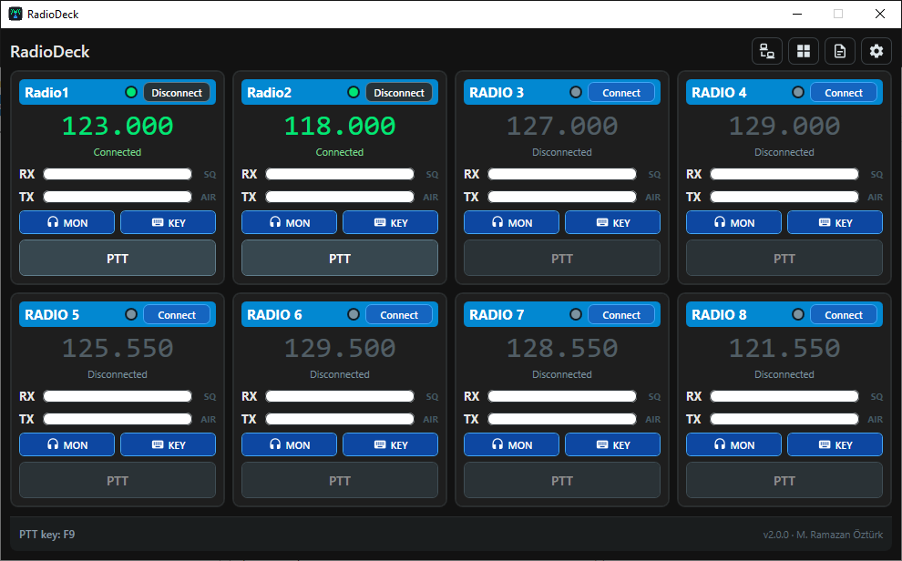
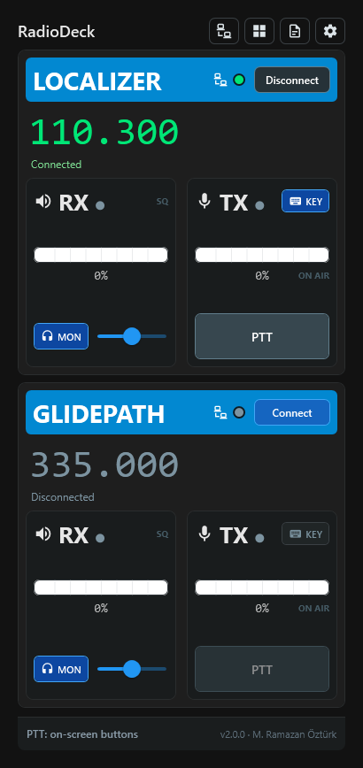
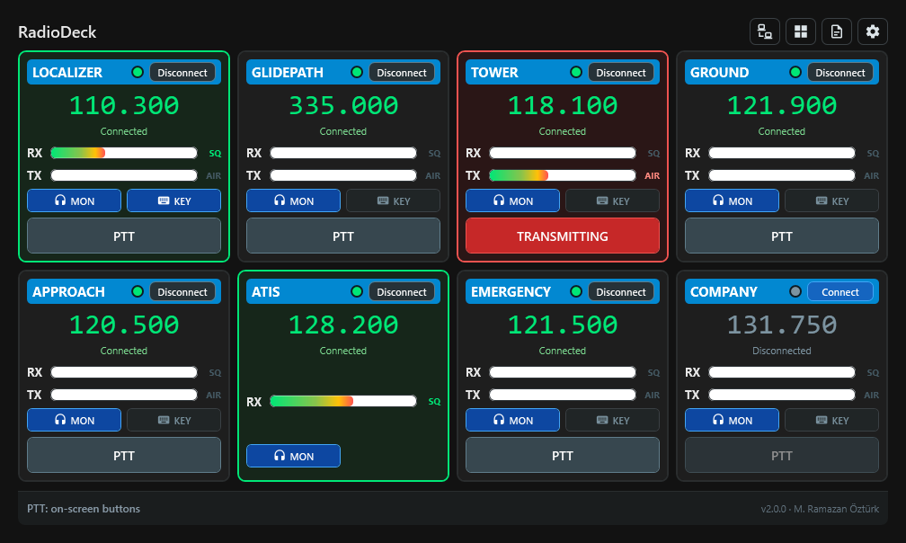
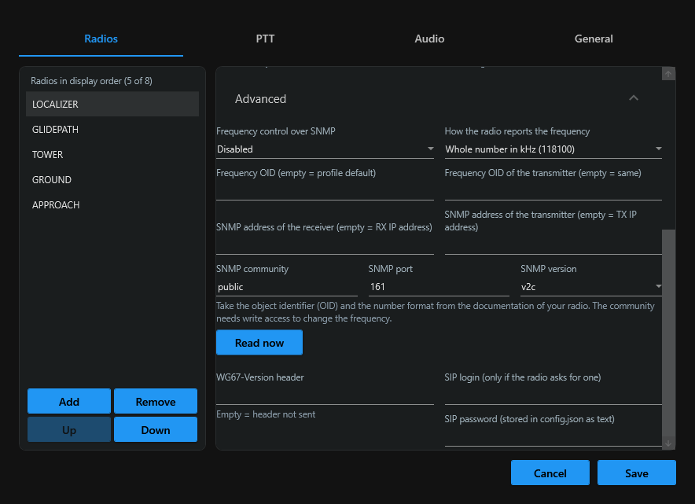

# RadioDeck

A Windows radio console for VoIP air-ground radios. It calls the radios directly
with SIP, exchanges G.711 A-law audio over RTP with ED-137 style signalling
(R2S keepalives, PTT in the RTP header extension) and gives the operator
push-to-talk, monitoring and frequency control for **one to eight radios**.

It was written for flight inspection work (localizer and glide path
frequencies) and has been tested on Jotron radios. Profiles for generic ED-137
radios are included but have not been tested on hardware.



**New here? Start with the illustrated [first setup guide](docs/GUIDE.md)**
([Türkçe: ilk kurulum rehberi](docs/GUIDE.tr.md)): installation, every window
with its buttons explained, and the first test with a radio. The installer is
on the [releases page](../../releases/latest).

| Classic view | Grid view with eight radios |
|---|---|
|  |  |

**Which view?** The classic view suits a small station that works with two
radios, for example a flight check with localizer and glide path. If you
connect more radios, switch to the grid view: it shows up to eight on one
screen. One button in the header switches between them.

The picture at the top was taken with two real radios connected. The other
screenshots show the built-in demo mode (`--demo`) with simulated radios.

> [!WARNING]
> **This is not certified equipment.** It is provided as is, without warranty
> (see `LICENSE`). Transmitting on aeronautical frequencies requires the
> appropriate licence and authorisation. Do not use it where a failure could
> endanger anyone, and verify it on your own radios before relying on it.
> It has been tested on Jotron radios and passes its automated checks against
> simulated radios; other radios have not been tried. See
> [Verification status](#verification-status).

## Features

- 1 to 8 radios, each with its own name, addresses and options
- Two views: **classic** (tall cards, two per column) and **grid** (square
  tiles, four per row, the fifth radio starts the second row)
- Push-to-talk with a global key that works while another program has the
  focus, and with on-screen buttons; a KEY switch per radio selects which
  radios the key transmits on
- Single-transmitter interlock with three arbitration modes, or simultaneous
  transmission on several radios
- Transmit time limit against a stuck PTT
- Automatic reconnect, optional connect on startup, a clear reason on the card
  when a call fails
- Receive monitoring per radio with volume and left/right balance, optional
  muting of all receivers while transmitting
- Squelch and "on air" indicators taken from the radio's own signalling
- Frequency read and set over SNMP, VHF and UHF; object, number format,
  version and SNMP address configurable per radio
- Input and output device selection; microphone clean-up (voice-band filter,
  rumble filter, optional background noise reduction, noise gate, limiter)
- Log window, daily log files, optional PIN for the settings
- User interface in 34 languages, see [Languages](#languages)

## Supported radios

| Profile | Status | What it sends |
|---|---|---|
| **Basic** | Tested on Jotron radios, see [Verification status](#verification-status) | `Subject: <freq> TxRx Radio-TxRx` / `<freq> Rx Radio-Rxonly`, offer with PCMA only, PTT-ID 1 |
| **Generic ED-137B** | **Untested on hardware** | `WG67-Version: radio.01`, `Subject: radio`, `Priority: normal`, offer with PCMA + R2S and `type` / `txrxmode` / `fid` attributes, PTT-ID assigned by the radio |
| **Generic ED-137C** | **Untested on hardware** | as ED-137B with `WG67-Version: radio.02` |

Each radio also has a **link mode**:

| Link mode | Sessions |
|---|---|
| Separate receiver and transmitter | one receive-only call and one transmit call, to two addresses |
| Transceiver | one call that carries both directions |
| Receiver only | one receive-only call; the radio has no PTT |

The generic profiles were implemented from the published behaviour of ED-137
radios and are exercised only against the simulated radio of the test suite.
If such a radio refuses the call, open the log window: it shows the INVITE, the
SDP in both directions and the radio's answer. The `WG67-Version` value can be
overridden per radio (Settings → Radios → Advanced). Reports and corrections
for other radios are welcome.

Not implemented: SIP registration, SRTP, codecs other than G.711 A-law,
best-signal selection (BSS), climax/offset operation, coupling/crosspatch,
SELCAL, recording.

## Requirements

- Windows 10 version 1809 or later, 64-bit
- A network path to the radios: SIP on UDP 5060 (configurable), RTP on the
  ports the radio announces, SNMP on UDP 161 for frequency control
- A headset or microphone and speakers
- To build: the .NET 8 SDK. A self-contained release needs nothing installed.

## Getting started

The [first setup guide](docs/GUIDE.md) shows these steps with pictures.

1. Start the program. A new installation shows two example radios.
2. Open **Settings** (gear button) → **Radios**. Enter a name and the IP
   address(es) of each radio, choose its profile and link mode, add more radios
   with **Add** (up to eight) and put them in the order you want with
   **Up** / **Down**. The name is free text and appears on the card.
3. On the **PTT** tab press **Capture** and then the key you want to use for
   push-to-talk (F9 by default).
4. Save. Press **Connect** on a radio, or the connect-all button in the header.
   The lamp and the status line show the result.
5. Hold the PTT key, or hold a radio's on-screen **PTT** button, to transmit.

Try it without radios: `RadioDeck.exe --demo`.

## The main window

Each radio shows:

- **Name** and a state lamp: grey = disconnected, amber = connecting or
  partly connected, green = connected, red = failed.
- **Connect / Cancel / Disconnect** button and a **status line** with the
  reason when something is wrong, e.g. `RX 192.0.2.11:5060: no answer within 8 s`.
- **Frequency.** Double-click to change it; Enter applies, Esc cancels. With
  frequency control the value is written to the radio and read back; a value
  that the radio has not confirmed yet is dimmed, an unknown one is `---.---`.
  Without frequency control it is only a label.
- **RX** level meter, **SQ** lamp (the receiver reports an open squelch) and
  the **MON** switch (play this receiver on the PC). The classic view also has
  the volume slider.
- **TX** level meter, **ON AIR / AIR** lamp (the transmitter confirms that it
  is keyed; not every radio reports this), the **KEY** switch (the global PTT
  key transmits on this radio) and the **PTT** button.

Header buttons: connect/disconnect all, switch view, log window, settings.

## Push-to-talk

- The PTT key is global: it works while another application has the focus or
  the window is minimised, and also while you edit a frequency. Choose a key
  you do not type with; a function key is a good choice. PTT is suspended only
  while the settings window is open.
- The key transmits on every connected radio whose **KEY** switch is on. An
  on-screen PTT button transmits on its own radio.
- **Single TX** (default on) allows one transmitter at a time. When several are
  requested: *First wins* keeps the radio that is already transmitting, *Last
  wins* gives the channel to the most recent press, *Priority* prefers the
  radio highest in the list. The previous transmitter is always released
  before the next one is keyed. With Single TX off, all requested radios
  transmit together.
- **Transmit time limit** (default 180 s, 0 = off) ends a transmission that is
  held too long. It stays off until every PTT input has been released.
- **Mute RX while TX** silences the local playback of all receivers while any
  radio transmits. Reception and keepalives continue.
- *Hide the PTT key from other applications* swallows the key so that it does
  not type into other programs.
- **Start of a transmission.** The transmitter and the receivers listening to
  it need a moment after PTT. The transmitter is keyed at once, but your voice
  is passed on 200 ms later (*Delay before speech*; at least 260 ms after a
  pause of five seconds). What you say meanwhile is delayed, not lost, so you
  can speak as you press.
- **End of a transmission.** After the release, the speech still inside the
  sound device and behind the delay is sent, and the transmitter stays keyed
  another 150 ms (*Hold after speech*) so the radio can play out its buffer.
  The transmitter therefore drops about 0.4 s after you let go.
- If the first syllable or the last word is still cut on the receiving side,
  raise the two values in Settings → Audio; lower them for less delay.
- If the microphone delivers nothing, silence is transmitted so the radio
  stays keyed for as long as PTT is held.

## Audio

**Microphone.** The microphone is captured at 48 kHz and converted to the
8 kHz the radio link uses with a proper filter, so hiss and other sounds above
the voice band do not fold back into it. Everything below about 250 Hz (wind
rumble, engine drone, mains hum) is removed, and loud peaks are rounded off
instead of clipped. These steps are always active.

**Background noise reduction** (Settings → Audio, off by default) turns down
steady noise around the microphone: engines, fans, wind. *Normal* lowers it by
about 12 dB, *Strong* by about 18 dB at the price of thinner speech. It adds
20 ms of delay. It follows the noise during the gaps between words, so it
needs a second or two after the noise changes. It was measured with test
signals, not tuned by ear on a radio channel: listen to the result on a second
receiver before relying on it. A close-talking, noise-cancelling headset
microphone still does more than any filter.

**Noise gate** (on by default) sends clean silence while nobody speaks. The
frames leading up to a word are sent when the gate opens, so the beginning is
not cut. Very quiet speech can stay below the gate; turn it off in that case.

**Received audio** is played after an 80 ms reserve has been collected, which keeps
the first word of a reception free of drop-outs, and the reserve is kept from
growing when the clocks of radio and PC drift apart. Volume above 100 % rounds
loud passages off instead of cutting them.

## Frequency control (SNMP)

The operating frequency is read and written with SNMP. The basic profile has a
default object for it (an integer in kHz, SNMP v2c); the generic profiles have
none, because every radio family uses its own. For a separate
receiver/transmitter pair both units are set. Accepted input: `123.450`,
`123,45`, `123450` or `123`, within 108–156 MHz or 225–400 MHz.

Per radio (Settings → Radios → Advanced):



| Setting | Meaning |
|---|---|
| Frequency control over SNMP | *Profile default*, *Enabled* or *Disabled* |
| How the radio reports the frequency | whole number in kHz (`118100`), whole number in Hz (`118100000`) or text in MHz (`118.100`) |
| Frequency OID | the object identifier of the frequency; empty = the default of the profile |
| Frequency OID of the transmitter | only if the transmitter uses a different object from the receiver |
| SNMP address of the receiver / transmitter | only if SNMP runs on a different address from SIP, e.g. a management interface; empty = the SIP address |
| SNMP community, port, version | default `public`, 161, v2c; v1 for older radios |
| **Read now** | reads the frequency with the values as entered, without saving, and shows the answer of each unit |

Take the OID and the number format from the documentation (MIB) of your
radio. The community must have write access to change the frequency. Integer,
Gauge/Unsigned and text answers are understood. SNMP v1 and v2c are not
encrypted; keep the radios on a closed network. SNMPv3 is not implemented.

These options were checked against a simulated SNMP agent only; on real
hardware only the default of the basic profile has been used.

## Network security

ED-137 radios are operated without encryption here: SIP, the audio (RTP) and
SNMP v1/v2c cross the network in clear text. Anyone who can listen on that
network can hear the audio and read the SNMP community, and with the community
change the frequency of a radio. **Keep the radios and this PC on a closed
network.**

What the program does on its side:

- Audio, keepalives and RTCP are accepted only from the media address the
  radio gave in its answer (any port of that address). A packet from another
  address is dropped: it is not played, does not move the SQ / ON AIR lamps
  and cannot draw the transmit audio to itself. The send destination stays
  where the radio's answer put it.
- SIP messages are accepted only from the addresses of the radio the entry
  calls, so another host cannot end a call or start one.
- An SNMP answer is accepted only from the unit that was asked.
- Dropped packets are noted in the log (`Ignored a packet from …`); a flood of
  them produces only a few lines.

Limits: a sender that forges the IP address of a radio is not recognised;
that needs encryption (SRTP, SNMPv3), which is not implemented. The SIP
password and the SNMP community are stored as text in `config.json`, readable
by the Windows account that runs the program. When Windows Firewall asks,
allow the program on the private network only; the rule can be narrowed to
the addresses of the radios.

## Settings reference

**Radios** — name, profile, link mode, receiver and transmitter address, SIP
port, SIP user names of the receiver and transmitter (the user part of the
called URI, e.g. `rx1`), frequency, volume, balance. Advanced: frequency
control over SNMP (see above), `WG67-Version`, SIP digest user and password
(only if the radio asks for authentication; stored in clear text in
`config.json`).

**PTT** — key, hide key, single TX and arbitration, mute RX while TX, transmit
time limit.

**Audio** — microphone, speaker/headset, background noise reduction, noise
gate, delay before speech, hold after speech.

**General** — language, view, always on top, organisation text for the footer,
automatic reconnect, connect on startup, settings PIN.

## Languages

Settings → General → **Language**. *Automatic* follows the display language of
Windows and falls back to English. The change applies when the settings are
saved; no restart is needed.

English, Türkçe, Deutsch, Français, Español, Português (Brasil), Italiano,
Nederlands, Polski, Čeština, Slovenčina, Magyar, Română, Български, Srpski,
Hrvatski, Ελληνικά, Українська, Русский, Svenska, Norsk bokmål, Dansk, Suomi,
العربية, فارسی, اردو, Қазақша, Oʻzbekcha, Кыргызча, Türkmençe, Тоҷикӣ,
Azərbaycanca, 日本語, 简体中文.

- **The translations were made by machine and have not been reviewed by native
  speakers.** English is the reference. Corrections are welcome.
- The short legends on the radio cards stay the same in every language: RX,
  TX, SQ, MON, KEY, PTT, ON AIR, MHz. The log is always written in English so
  that it can be passed on.
- Arabic, Persian and Urdu switch the windows to right-to-left. Addresses,
  frequencies and other technical values stay left-to-right.

Every language is one file, [`Localization/<code>.json`](Localization), with
`en.json` as the reference; a missing text is shown in English. To correct or
add a translation, edit that file as described in
[`Localization/TRANSLATING.md`](Localization/TRANSLATING.md) (a new language
also needs one line in the list in `Services/Localization/Loc.cs`) and run the
regression suite: it checks that every file has all texts, the same
placeholders and that the button texts fit. `--render-ui <folder> --lang <code>`
writes pictures of all windows in that language to check the layout.

## Files

| What | Where |
|---|---|
| Configuration | `%AppData%\RadioDeck\config.json` |
| Log files (30 days) | `%AppData%\RadioDeck\logs\radio-YYYYMMDD.log` |
| Crash log | `%AppData%\RadioDeck\logs\crash-YYYYMMDD.log` |
| Optional footer logo | `%AppData%\RadioDeck\logo.png` (or `.jpg`) |

A configuration file that cannot be read is never overwritten silently: a copy
is kept as `config.unreadable-<time>.json`, defaults are used and the main
window says so. A configuration file from an earlier release is converted on
first start; the original is kept as `config.v1-backup.json`.

The settings PIN keeps operators from changing addresses by accident. It is
stored as a salted hash, but it is not a protection against someone who can
edit `config.json`: deleting the `Security` entries removes it.

## Command line

| Option | Effect |
|---|---|
| *(none)* | normal operation |
| `--demo` | eight simulated radios; no network, no audio device, no key hook, nothing saved |
| `--render-ui <folder>` | writes PNG pictures of the demo windows to the folder and exits (used for the screenshots here and in the guide) |
| `--lang <code>` | language of the demo and of the pictures, e.g. `--demo --lang de`; normal operation takes the language from the settings |

## Building

```powershell
dotnet build .\RadioDeck.csproj -c Release
dotnet run --project .\tests\PttRegression\PttRegression.csproj -c Release
```

The regression suite takes a little over a minute. It uses simulated radios on
127.0.0.1 only and never contacts the addresses in your configuration. It
covers PTT arbitration and timing for up to eight radios, the configuration
migration, the settings logic and the SIP/RTP engine on the wire for all three
radio profiles, the audio processing with test signals, frequency control
against an SNMP agent on the loopback interface, the language files, and the
handling of forged and malformed packets from another loopback address.
`-- --native-keyboard` additionally injects an F24 key press into Windows to
test the global key hook. `-- --native-audio` runs only a two-second check of
the default microphone on this PC.

Self-contained release and installer (the installer needs Inno Setup 6):

```powershell
powershell -ExecutionPolicy Bypass -File .\scripts\publish.ps1 -Runtime win-x64
powershell -ExecutionPolicy Bypass -File .\scripts\build-installer.ps1 -Runtime win-x64
```

`build-installer.ps1` runs the regression checks, publishes, runs the checks
again against the packaged assembly and compiles `artifacts\installer\RadioDeckSetup.exe`.
Keep the published folder together; the program is not a single file.

SIPSorcery is pinned to 10.0.17: the engine relies on details of exactly that
version (the test suite fails loudly if they change) and it contains the fixes
for GHSA-28gm-jrmw-xx93 and GHSA-jwjp-4649-v8jp.

## Verification status

| Area | Status |
|---|---|
| Regression suite against simulated radios (75 checks) | passes |
| Source filtering of RTP, SIP and SNMP | checked on the loopback interface with a second address as intruder; **not yet re-checked on real radios** |
| Basic profile on Jotron radios | tested: connect, receive, transmit with PTT, frequency change, start and end of a transmission not cut, long idle periods, automatic reconnect |
| Microphone clean-up, noise reduction, playback buffer | measured with test signals and listened to on Jotron radios |
| Generic ED-137B / ED-137C radios | **never verified on hardware** |
| SNMP with another OID, Hz or text format, SNMP v1, or a separate SNMP address | checked against a simulated agent; **never verified on hardware** |
| Translations | made by machine; **not reviewed by native speakers**. Layout checked on pictures of a sample of languages, including right-to-left |
| Audio devices, USB headsets, PTT foot switches | depend on the PC; check on the target machine |

Before operational use, run an acceptance test on your own radios: connect,
receive and transmit on each radio, check the first syllable and the last word
on a monitor receiver, leave the calls idle for several minutes, then unplug
the network and watch the reconnect.

## Troubleshooting

| Status line | Meaning |
|---|---|
| `no answer within 8 s` | Nothing answered at that address and port: wrong IP, cable, firewall, radio off. |
| `the radio answered 404 Not Found` | The radio does not know the SIP user. The call is repeated automatically without the user part; check the RX/TX user. |
| `the radio answered 486 …` / `503 …` | The radio is busy, usually with another console session. |
| `the radio answered 4xx/6xx` on a generic profile | The radio does not accept the offer; see the log window and try the other ED-137 profile or `WG67-Version`. |
| `RX only` / `TX only` | One of the two sessions is up; the reason for the other follows. |
| `… — retrying` | Automatic reconnect is on; the call is repeated after 2, 4, 8 and then every 15 s. |
| `call ended by the radio or the network` | The radio hung up or stopped sending keepalives. |
| Connected, but no audio or the call drops after 30 s; the log shows `Ignored a packet from …` | Packets arrive from an address other than the one the radio gave in its answer and are dropped, see [Network security](#network-security). If that address is the radio's own second interface, please report it. |
| `Frequency not changed: …` | SNMP did not answer or refused: check the community (write access), the port and that SNMP is enabled on the radio. Use **Read now** in Settings → Radios → Advanced to try the SNMP values. |
| `the radio does not provide this frequency object` | The OID is not known to the radio: compare it with the radio's documentation. |
| `the answer is not a frequency (…)` | The radio answered with something other than a frequency: choose the matching number format. |

The log window (and the log files) record every SIP request and answer, the SDP,
keepalive and PTT events.

## Project layout

```
docs/          first setup guide (English and Turkish) and the screenshots
Localization/  one JSON file per language, en.json is the reference
Models/        configuration and radio profiles
Services/      SIP/RTP engine, PTT controller, keyboard hook, SNMP, audio, log, languages
ViewModels/    main window, one radio, settings
Views/         settings, log and PIN windows
tests/         regression suite (console program)
scripts/       publish and installer scripts
Installer/     Inno Setup script
```

## License

MIT, see [`LICENSE`](LICENSE). Third-party components and their licences are
listed in [`THIRD-PARTY-NOTICES.md`](THIRD-PARTY-NOTICES.md); note the
additional use restriction in the SIPSorcery licence, which also applies to
binary releases of this program. Both files are copied into every build and
must stay with any copy of the program that is passed on.

This project is not affiliated with or endorsed by Jotron, any other radio
manufacturer or any standards body.

RadioDeck was developed with the help of AI tools.

---

## Türkçe özet

RadioDeck, ED-137 tarzı işaretleşme kullanan VoIP hava-yer
telsizlerini Windows bilgisayardan kullanmak için bir konsoldur.

**Resimli [ilk kurulum rehberi](docs/GUIDE.tr.md)** kurulumu, bütün
pencereleri ve düğmeleri, ilk bağlantı denemesini adım adım anlatır.

- Arayüz 34 dilde kullanılabilir; Türkçe dahildir. Dil, Ayarlar → Genel →
  Dil bölümünden seçilir; "Otomatik" Windows dilini izler. Çeviriler makineyle
  yapılmıştır, esas alınan dil İngilizcedir.
- 1–8 telsiz; her telsizin adı, IP adresleri ve ayarları Ayarlar → Telsizler
  sekmesinden girilir.
- İki görünüm: klasik (uzun kartlar) ve ızgara (ilk satırda dört telsiz,
  sonrası alt satıra geçer). İki telsizle çalışan küçük istasyonlarda, örneğin
  flight check (uçuş kontrol) çalışmasında klasik görünüm uygundur; daha çok
  telsiz bağlanacaksa ızgara görünümü kullanılabilir.
- Genel PTT tuşu (varsayılan F9), ekrandaki PTT düğmeleri, tek verici kilidi,
  gönderme süre sınırı, otomatik yeniden bağlanma.
- SNMP ile frekans okuma/yazma (VHF ve UHF). Farklı telsizler için OID, sayı
  biçimi (kHz, Hz veya MHz metni), SNMP sürümü ve ayrı SNMP adresi telsiz
  başına girilebilir (Ayarlar → Telsizler → Gelişmiş); "Şimdi oku" düğmesi
  değerleri kaydetmeden dener.
- Temel (Basic) profil Jotron telsizlerinde denenmiştir (bağlantı, alma, PTT
  ile gönderme, frekans değiştirme, uzun süre boşta bekleme, otomatik yeniden
  bağlanma). Genel ED-137B/C profilleri **gerçek cihazda denenmemiştir**.
  Kullanmadan önce kendi telsizlerinizde kabul testi yapın.
- Telsiz olmadan denemek için: `RadioDeck.exe --demo`

Bu yazılım sertifikalı bir cihaz değildir ve hiçbir garanti verilmez. Havacılık
frekanslarında yayın yapmak yetki gerektirir. Jotron veya başka bir telsiz
üreticisiyle bağlantısı yoktur.

RadioDeck yapay zekâ araçlarının yardımıyla geliştirilmiştir.
