# RadioDeck – first setup guide

*[Türkçe](GUIDE.tr.md)*

This guide takes you from the download to the first transmission and explains
every window of the program. The reference for all details is the
[README](../README.md).

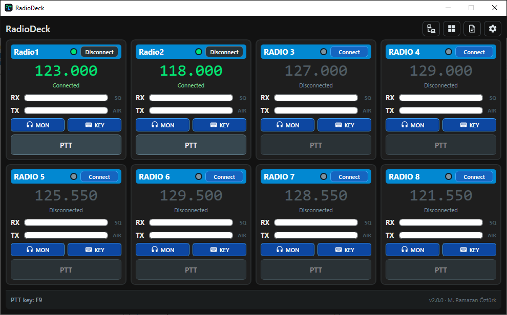

*RadioDeck in the grid view with two real radios connected. The other pictures
in this guide were made in demo mode with simulated radios.*

> [!WARNING]
> RadioDeck is not certified equipment and comes without warranty. Transmitting
> on aeronautical frequencies requires the appropriate licence and
> authorisation. Check the program on your own radios before you rely on it.

## Contents

1. [What you need](#1-what-you-need)
2. [Install](#2-install)
3. [The first start](#3-the-first-start)
4. [The main window](#4-the-main-window)
5. [Enter your radios](#5-enter-your-radios)
6. [Choose the PTT key](#6-choose-the-ptt-key)
7. [Audio devices](#7-audio-devices)
8. [General options](#8-general-options)
9. [Connect and test](#9-connect-and-test)
10. [Change the frequency](#10-change-the-frequency)
11. [The log window](#11-the-log-window)
12. [If something does not work](#12-if-something-does-not-work)
13. [Update and remove](#13-update-and-remove)

## 1. What you need

- A PC with Windows 10 (version 1809 or later) or Windows 11, 64-bit.
- A headset, or a microphone and speakers.
- A network connection to the radios. The PC needs an address on the same
  network as the radios, or a route to them. Check it first:
  open a command prompt and type `ping` followed by the address of a radio.
- From the configuration of each radio:

  | What | Example | Where it goes |
  |---|---|---|
  | IP address of the receiver and of the transmitter (or one address for a transceiver) | `192.0.2.11`, `192.0.2.12` | Settings → Radios |
  | SIP user name the radio expects, if any | `rx1`, `tx1` | Settings → Radios |
  | SIP port, if it is not 5060 | `5060` | Settings → Radios |
  | For frequency control: SNMP community with write access, and for radios other than the basic profile the frequency object (OID) | `public` | Settings → Radios → Advanced |

- The radios must be set up for VoIP operation (ED-137) and must allow a call
  from the PC. A radio that is already in use by another console may refuse a
  second one.

No radio at hand? The program has a demo mode with simulated radios, see
[The first start](#3-the-first-start).

## 2. Install

1. Download `RadioDeckSetup.exe` from the
   [latest release](../../../releases/latest).
2. Start it. The file is not digitally signed, so Windows may show
   *Windows protected your PC*. Choose **More info** and then **Run anyway**.
   Windows then asks for administrator permission.
3. Follow the wizard. The program is installed to `C:\Program Files\RadioDeck`
   and gets an entry in the Start menu; a desktop icon is optional.
4. Leave *Launch RadioDeck* ticked on the last page, or start the program from
   the Start menu.

Nothing else has to be installed; the .NET runtime is included.

## 3. The first start

- The program starts in the language of Windows (34 languages; English when
  yours is not among them). You can change it in Settings → General.
- A new installation shows two example radios, **LOCALIZER** and **GLIDEPATH**,
  with example addresses. They are placeholders: replace them with your own
  radios in [step 5](#5-enter-your-radios).
- When you connect for the first time, **Windows Firewall** may ask whether the
  program may communicate. Allow it for **private networks** only. If you
  refuse, the radios may not be able to reach the program.
- Only one copy of the program runs at a time. Starting it again brings the
  running window to the front.

**Demo mode.** To look at the program without radios, start it with `--demo`:
press <kbd>Win</kbd>+<kbd>R</kbd> and enter

```
"C:\Program Files\RadioDeck\RadioDeck.exe" --demo
```

Eight simulated radios appear. Nothing is sent to the network and no setting is
saved.

## 4. The main window

There are two views. The **classic view** shows tall cards with large
indicators, two per column:

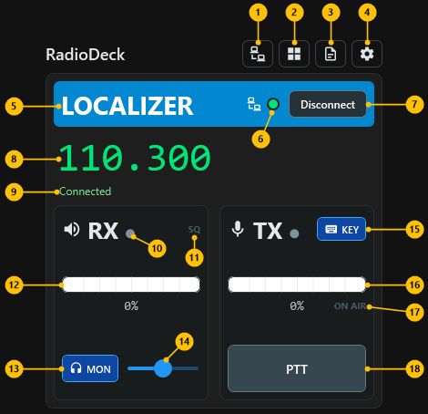

The **grid view** shows compact tiles, four per row, for up to eight radios.
The numbers mean the same in both pictures:

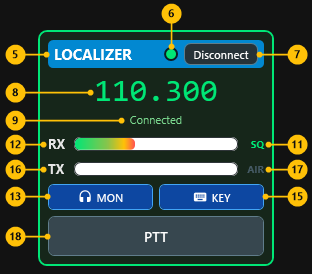

**Which view?** The classic view suits a small station that works with two
radios, for example a flight check with localizer and glide path. If you
connect more radios, use the grid view; it keeps up to eight on one screen.

**Buttons at the top**

| No. | Element | What it does |
|---|---|---|
| 1 | Connect all | Connects every radio, or disconnects all when they are connected. |
| 2 | View | Switches between the classic and the grid view. |
| 3 | Log | Opens the [log window](#11-the-log-window). |
| 4 | Settings | Opens the settings. PTT is suspended while they are open. |

**On every radio**

| No. | Element | What it does |
|---|---|---|
| 5 | Name | The name you gave the radio. Rest the mouse on it to see its addresses. |
| 6 | State lamp | Grey = disconnected, amber = connecting or only partly connected, green = connected, red = failed. |
| 7 | Connect | **Connect** calls the radio, **Cancel** stops a call that is being set up, **Disconnect** ends it. |
| 8 | Frequency | Double-click to change it, see [step 10](#10-change-the-frequency). Bright = confirmed by the radio, dimmed = last known value, `---.---` = unknown. |
| 9 | Status line | The state in words, and the reason when something failed, e.g. *no answer within 8 s*. |
| 10 | Activity dot | Next to RX: green while audio is received. Next to TX: green while audio is sent. (Classic view only.) |
| 11 | SQ | Lights when the receiver reports an open squelch, that is, when it receives a signal. |
| 12 | RX meter | Level of the received audio. |
| 13 | MON | Monitor switch: on = the received audio of this radio is played on the PC. Off silences only the playback; the connection stays up. |
| 14 | Volume | Loudness of this radio. In the grid view the volume is set in Settings → Radios. |
| 15 | KEY | On = the PTT key of the keyboard transmits on this radio. Switch it off for radios you only listen to. |
| 16 | TX meter | Level of your microphone while you transmit. |
| 17 | ON AIR / AIR | Lights when the transmitter confirms that it is keyed. Not every radio reports this. |
| 18 | PTT | Hold with the mouse to transmit on this radio only. It turns red and shows **TRANSMITTING** while the radio is keyed. |

A radio that receives is highlighted in green; a radio that transmits shows
the red **TRANSMITTING** button:

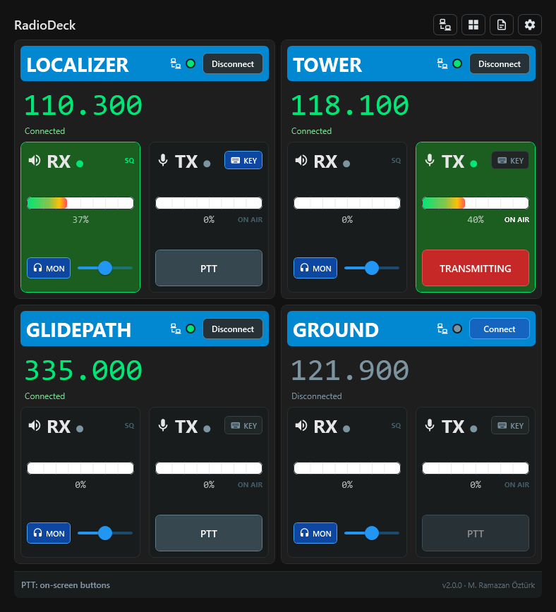

**Footer.** On the left the PTT key in use (or *PTT: on-screen buttons* when
no key is available), on the right the version and the organisation text from
Settings → General. Warnings appear in a coloured bar below the buttons at the
top, for example when the transmit time limit has stopped a transmission.

## 5. Enter your radios

Open **Settings** (button 4) and stay on the **Radios** tab.

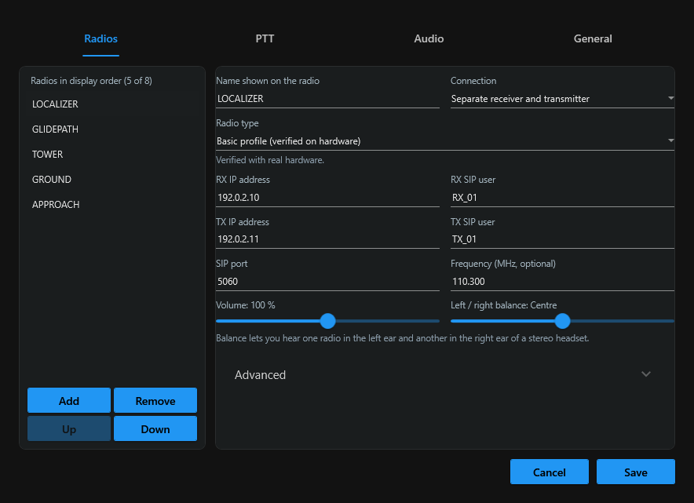

The list on the left holds the radios in the order in which they are shown.
**Add** creates a new one (up to eight), **Remove** deletes the selected one,
**Up** and **Down** change the order. Select a radio and fill in the right
side:

| Field | Meaning |
|---|---|
| Name shown on the radio | Free text, e.g. `TOWER` or `118.100`. Every radio needs its own name. |
| Connection | **Separate receiver and transmitter**: two units with two addresses. **Transceiver (one address)**: one unit for both directions. **Receiver only**: listening only, the radio gets no PTT. |
| Radio type | **Basic profile** has been tested on Jotron radios. **Generic ED-137B** and **ED-137C** follow the standard but have not been checked on hardware; try them if the basic profile is refused. |
| RX IP address / TX IP address | The addresses of the receiver and of the transmitter. A transceiver has one field, *Radio IP address*. |
| RX SIP user / TX SIP user | The user name the radio expects in the call, if it expects one. When the radio does not know the name, the call is repeated without it. |
| SIP port | 5060 unless the radio is set otherwise. |
| Frequency (MHz, optional) | The value shown until the radio reports its own; for radios without frequency control it is only a label. |
| Volume | 0 to 200 %. |
| Left / right balance | Puts the radio in the left or the right ear of a stereo headset, so that two radios can be told apart. |

**Save** stores everything; **Cancel** discards the changes. Only the radios
whose address, user or type changed are reconnected.

### Advanced: frequency control and login

Click **Advanced** below the sliders. Most installations need nothing here.

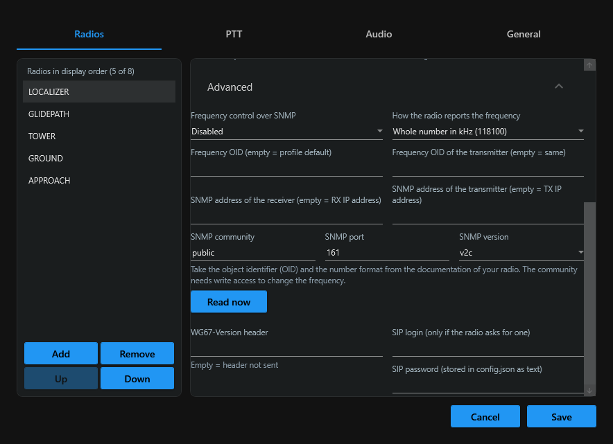

| Field | Meaning |
|---|---|
| Frequency control over SNMP | *Profile default*, *Enabled* or *Disabled*. With frequency control the program reads the frequency from the radio and can change it. |
| How the radio reports the frequency | Whole number in kHz, whole number in Hz, or text in MHz. Take it from the documentation of the radio. |
| Frequency OID | The object that holds the frequency. Empty uses the default of the radio type; the generic types have none. |
| Frequency OID of the transmitter | Only when the transmitter uses a different object from the receiver. |
| SNMP address of the receiver / transmitter | Only when SNMP runs on a different address from the calls, e.g. a management interface. |
| SNMP community, port, version | Usually `public`, 161 and v2c. The community needs write access to change the frequency. |
| **Read now** | Reads the frequency with the values as entered, without saving them, and shows the answer of each unit. Use it to try the values. |
| WG67-Version header | Only for the generic radio types, when the radio asks for another value. |
| SIP login and password | Only when the radio asks for authentication. The password is stored as plain text in the configuration file. |

More about SNMP: [Frequency control](../README.md#frequency-control-snmp) in
the README.

## 6. Choose the PTT key

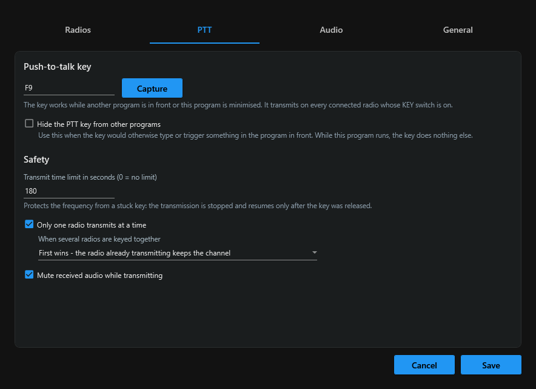

| Field | Meaning |
|---|---|
| Push-to-talk key | Press **Capture** and then the key you want. F9 is preset. Choose a key you do not type with; a function key is a good choice. |
| Hide the PTT key from other programs | The key then does nothing in the program in front (it does not type or trigger anything there). |
| Transmit time limit | Stops a transmission that lasts longer, as protection against a stuck key. 180 seconds is preset; 0 switches the limit off. |
| Only one radio transmits at a time | On: one transmitter at a time. Off: every keyed radio transmits together. |
| When several radios are keyed together | *First wins*: the radio already transmitting keeps the channel. *Last wins*: the most recent press takes over. *Priority*: the radio highest in the list wins. |
| Mute received audio while transmitting | Silences the playback of all receivers while you transmit, so that you do not hear yourself. |

The key works while another program is in front or RadioDeck is minimised. It
transmits on every connected radio whose **KEY** switch (15) is on. A USB foot
switch or hand switch that sends a keyboard key should be captured the same
way; check it on your PC.

## 7. Audio devices

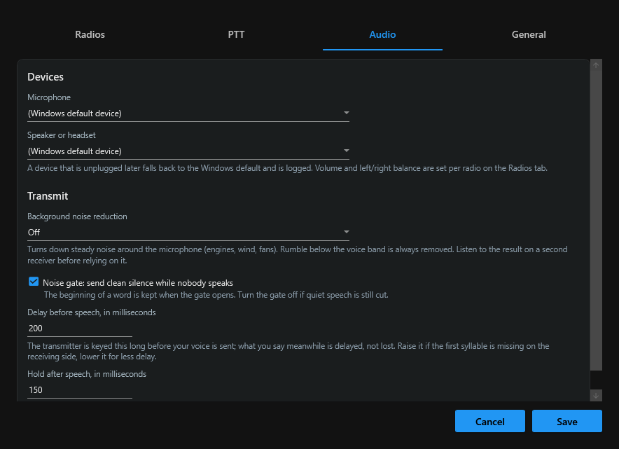

| Field | Meaning |
|---|---|
| Microphone | The input device. *Windows default device* follows the Windows setting. |
| Speaker or headset | The output device. |
| Background noise reduction | Off, Normal or Strong. Turns down steady noise around the microphone such as engines or fans. Listen to the result on a second receiver before you rely on it. |
| Noise gate | On: clean silence is sent while nobody speaks. Switch it off if quiet speech is cut. |
| Delay before speech | Time between keying the transmitter and sending your voice (200 ms preset). Raise it if the first syllable is missing on the receiving side. |
| Hold after speech | Time the transmitter stays keyed after the last word (150 ms preset). Raise it if the end is cut. |

Set the microphone level in Windows so that the TX meter (16) moves clearly
while you speak, without staying at the top.

## 8. General options

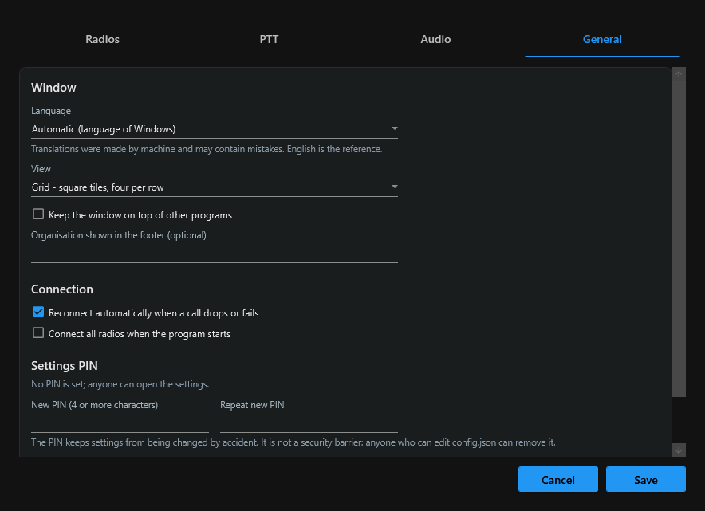

| Field | Meaning |
|---|---|
| Language | *Automatic* follows Windows. The change applies when you save; no restart is needed. |
| View | The view the program starts in: classic or grid. |
| Keep the window on top | The window stays visible above other programs. |
| Organisation shown in the footer | Free text at the bottom right of the main window. |
| Reconnect automatically | A call that fails or drops is repeated after 2, 4, 8 and then every 15 seconds. |
| Connect all radios when the program starts | Useful for a PC that only runs this program. |
| Settings PIN | Enter a PIN of four or more characters twice to protect the settings against accidental changes. **Remove the PIN** deletes it. |

With a PIN set, the settings ask for it:

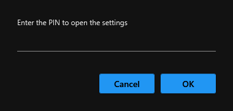

After three wrong entries the settings stay locked for 30 seconds. The PIN
protects against mistakes, not against someone with access to the PC: it can
be removed in the configuration file.

## 9. Connect and test

Do this once for every radio, with a second receiver or a colleague who
listens.

1. Press **Connect** (7) on the radio, or **Connect all** (1). The lamp (6)
   turns amber and then green; the status line (9) shows *Connected*.
   If it turns red, the status line names the reason; see
   [step 12](#12-if-something-does-not-work).
2. **Receive.** Have someone transmit on the frequency. **SQ** (11) lights,
   the RX meter (12) moves, and you hear the audio when **MON** (13) is on.
3. **Transmit.** Switch **KEY** (15) on and hold the PTT key, or hold the
   **PTT** button (18) with the mouse. The button shows **TRANSMITTING**, the
   TX meter (16) follows your voice, and **ON AIR** (17) lights if the radio
   reports it. Ask the listener whether the first and the last word arrive
   complete.
4. **Leave the connection idle** for a few minutes. The lamp must stay green.
5. With several radios, switch **KEY** on only for the radio you want to talk
   on. With *Only one radio transmits at a time* just one of the selected
   radios is keyed.

## 10. Change the frequency

Double-click the frequency (8). Type the new value and press **Set** or
<kbd>Enter</kbd>; **Cancel** or <kbd>Esc</kbd> leaves it unchanged.

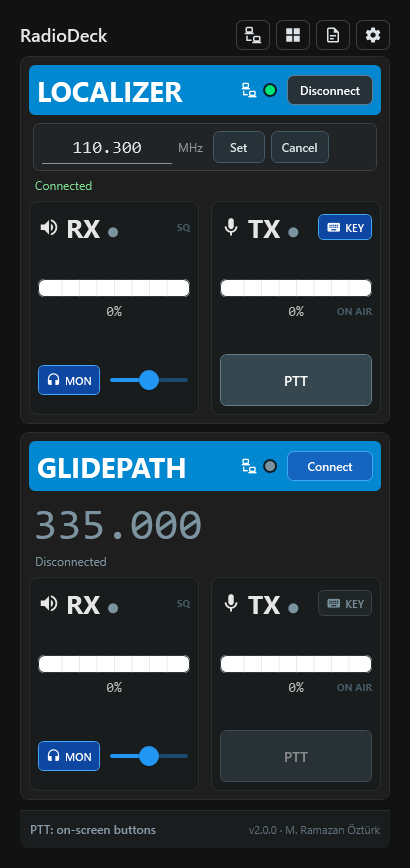

Accepted input: `123.450`, `123,45`, `123450` or `123`, within 108–156 MHz or
225–400 MHz. With frequency control the value is written to the receiver and
the transmitter and read back; it stays dimmed until the radio has confirmed
it. If the radio refuses, the status line says *Frequency not changed* and
why. Without frequency control the number is only a label on the card.

## 11. The log window

Button 3 opens the log. It records every call with the answer of the radio,
the keepalives and every PTT, always in English so that it can be passed on.

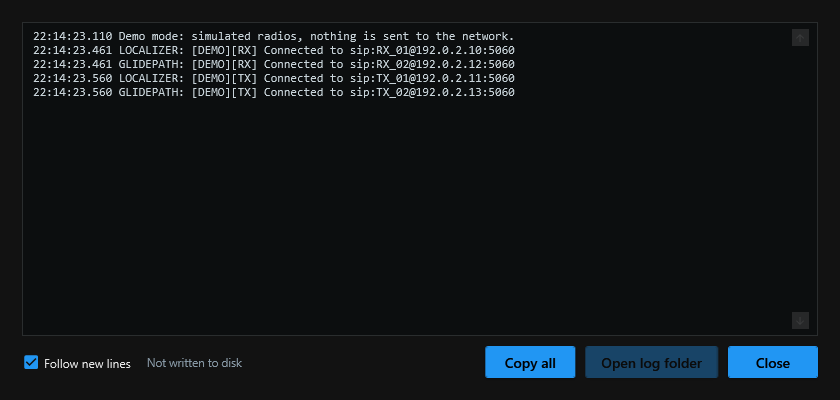

| Element | What it does |
|---|---|
| Follow new lines | Keeps the newest line in view. Untick it to read older lines in peace. |
| Copy all | Copies the log to the clipboard, e.g. to attach it to a problem report. |
| Open log folder | Opens the folder with the daily log files. They are kept for 30 days. |

Before you pass a log on, look through it: it contains the addresses and SIP
user names of your radios.

## 12. If something does not work

| What you see | What to check |
|---|---|
| *no answer within 8 s* | The address, the cable, the firewall, whether the radio is switched on. Try `ping`. |
| *the radio answered 404 Not Found* | The radio does not know the SIP user name. |
| *the radio answered 486 …* or *503 …* | The radio is busy, usually with another console. |
| A generic radio type is refused | Open the log, try the other ED-137 type or another *WG67-Version*. |
| Connected, but no audio | Windows Firewall (allow the program on private networks), the **MON** switch, the output device in Settings → Audio, the volume of the radio. |
| Nobody hears you | The **KEY** switch, the microphone in Settings → Audio, the microphone level in Windows. Does the TX meter move? |
| The PTT key does nothing | Is the settings window still open? Is another radio already transmitting? Capture the key again in Settings → PTT. |
| *Frequency not changed* | The SNMP community (write access), the port, SNMP switched on at the radio. Try **Read now** in Settings → Radios → Advanced. |

The full list is in the README under
[Troubleshooting](../README.md#troubleshooting).

## 13. Update and remove

- **Update:** install the new `RadioDeckSetup.exe` over the old version. Close
  the program first. Your settings are kept.
- **Remove:** Windows Settings → Apps → RadioDeck → Uninstall.
- **Your settings** are in `%AppData%\RadioDeck\config.json`, the logs in
  `%AppData%\RadioDeck\logs`. They stay when the program is removed; delete
  the folder to remove them too. To move the settings to another PC, copy
  `config.json`.
