# RadioDeck – ilk kurulum rehberi

*[English](GUIDE.md)*

Bu rehber sizi indirmeden ilk göndermeye kadar götürür ve programın her
penceresini açıklar. Ayrıntıların tamamı (İngilizce) [README](../README.md)
dosyasındadır.

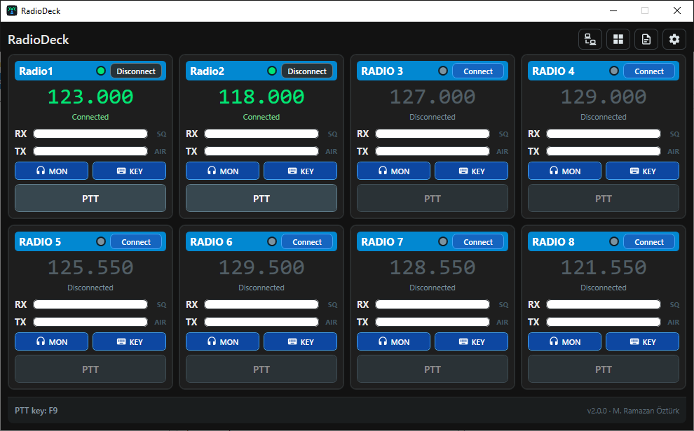

*Izgara görünümünde, iki gerçek telsiz bağlıyken RadioDeck. Rehberdeki diğer
resimler demo modunda, benzetilmiş telsizlerle hazırlanmıştır.*

> [!WARNING]
> RadioDeck sertifikalı bir cihaz değildir ve hiçbir garanti verilmez.
> Havacılık frekanslarında yayın yapmak lisans ve yetki gerektirir. Programa
> güvenmeden önce kendi telsizlerinizde deneyin.

## İçindekiler

1. [Gerekenler](#1-gerekenler)
2. [Kurulum](#2-kurulum)
3. [Programı ilk kez açma](#3-programı-ilk-kez-açma)
4. [Ana pencere](#4-ana-pencere)
5. [Telsizleri girme](#5-telsizleri-girme)
6. [PTT tuşunu seçme](#6-ptt-tuşunu-seçme)
7. [Ses aygıtları](#7-ses-aygıtları)
8. [Genel seçenekler](#8-genel-seçenekler)
9. [Bağlanma ve deneme](#9-bağlanma-ve-deneme)
10. [Frekans değiştirme](#10-frekans-değiştirme)
11. [Günlük penceresi](#11-günlük-penceresi)
12. [Bir şey çalışmıyorsa](#12-bir-şey-çalışmıyorsa)
13. [Güncelleme ve kaldırma](#13-güncelleme-ve-kaldırma)

## 1. Gerekenler

- 64 bit Windows 10 (sürüm 1809 veya sonrası) ya da Windows 11 yüklü bir
  bilgisayar.
- Bir kulaklık, ya da mikrofon ve hoparlör.
- Telsizlere ağ bağlantısı. Bilgisayarın telsizlerle aynı ağda bir adresi ya
  da onlara giden bir yolu olmalıdır. Önce bunu deneyin: komut istemini açıp
  `ping` yazın ve ardına bir telsizin adresini ekleyin.
- Her telsizin yapılandırmasından şu bilgiler:

  | Bilgi | Örnek | Girileceği yer |
  |---|---|---|
  | Alıcının ve vericinin IP adresi (alıcı-verici tek cihazsa tek adres) | `192.0.2.11`, `192.0.2.12` | Ayarlar → Telsizler |
  | Telsiz bekliyorsa SIP kullanıcı adı | `rx1`, `tx1` | Ayarlar → Telsizler |
  | 5060 değilse SIP portu | `5060` | Ayarlar → Telsizler |
  | Frekans kontrolü için: yazma yetkili SNMP topluluk adı; temel profil dışındaki telsizlerde ayrıca frekans nesnesi (OID) | `public` | Ayarlar → Telsizler → Gelişmiş |

- Telsizler VoIP (ED-137) çalışmasına ayarlı olmalı ve bilgisayardan gelen
  çağrıya izin vermelidir. Başka bir konsolun kullandığı telsiz ikinci bir
  çağrıyı reddedebilir.

### Bağlantı şeması

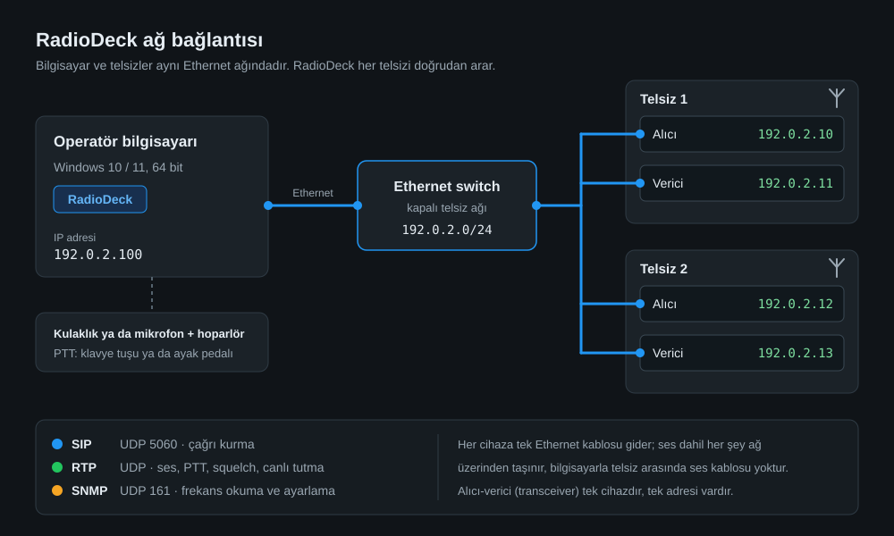

RadioDeck için sunucu, ağ geçidi ya da ses kablosu gerekmez. Bilgisayar ve
telsizler aynı Ethernet ağına takılır, program her telsizi bu ağ üzerinden
doğrudan arar. Ses, PTT ve frekans komutlarının hepsi bu tek ağdan geçer.

1. Her alıcının, vericinin ya da alıcı-vericinin Ethernet (LAN) portunu
   switch'e bağlayın.
2. Bilgisayarı aynı switch'e bağlayın.
3. Bilgisayara telsizlerin ağında sabit bir IP adresi verin: Windows Ayarlar →
   Ağ ve internet → Ethernet → IP ataması → **Düzenle** → *El ile*. Örneğin
   telsizler `192.0.2.10` – `192.0.2.13` ise bilgisayara `192.0.2.100`
   adresini ve `255.255.255.0` alt ağ maskesini verin.
4. Bilgisayardan her cihaza `ping` atarak bağlantıyı deneyin.
5. Kulaklığı bilgisayara takın.

Resimdeki adresler örnektir; kendi telsizlerinizin adreslerini kullanın. Her
cihazın kendi adresi vardır: ayrı alıcı ve verici için iki adres, alıcı-verici
için tek adres gerekir.

Bilgisayar telsizlere bir yönlendirici üzerinden de ulaşabilir; bunun için
SIP (UDP 5060), ses (RTP, UDP) ve SNMP (UDP 161) iki yönde de geçebilmelidir.
Bu ağdaki hiçbir şey şifreli değildir, ağı kapalı tutun; bkz. README'deki
[Network security](../README.md#network-security) bölümü.

Elinizde telsiz yok mu? Programın benzetilmiş telsizlerle çalışan bir demo
modu vardır, bkz. [Programı ilk kez açma](#3-programı-ilk-kez-açma).

## 2. Kurulum

1. `RadioDeckSetup.exe` dosyasını [son sürüm](../../../releases/latest)
   sayfasından indirin.
2. Dosyayı çalıştırın. Dosya dijital olarak imzalı olmadığı için Windows
   *Windows kişisel bilgisayarınızı korudu* uyarısını gösterebilir. **Ek
   bilgi**'ye, ardından **Yine de çalıştır**'a tıklayın. Windows bundan sonra
   yönetici izni ister.
3. Sihirbazı izleyin (sihirbaz İngilizcedir). Program
   `C:\Program Files\RadioDeck` klasörüne kurulur ve Başlat menüsüne eklenir;
   masaüstü simgesi isteğe bağlıdır (*Create a desktop icon*).
4. Son sayfada *Launch RadioDeck* işaretli kalsın, ya da programı Başlat
   menüsünden açın.

Başka bir şey kurmak gerekmez; .NET çalışma ortamı kurulumun içindedir.

## 3. Programı ilk kez açma

- Program Windows'un dilinde açılır (34 dil; Türkçe dahil). Dili Ayarlar →
  Genel bölümünden değiştirebilirsiniz.
- Yeni kurulumda örnek adreslerle iki örnek telsiz görünür: **LOCALIZER** ve
  **GLIDEPATH**. Bunlar yer tutucudur; [5. adımda](#5-telsizleri-girme) kendi
  telsizlerinizle değiştirin.
- İlk bağlantıda **Windows Güvenlik Duvarı** programın iletişim kurmasına
  izin verilip verilmeyeceğini sorabilir. Yalnızca **özel ağlar** için izin
  verin. İzin vermezseniz telsizler programa ulaşamayabilir.
- Program aynı anda yalnızca bir kez çalışır. Yeniden başlatırsanız açık olan
  pencere öne gelir.

**Demo modu.** Programı telsiz olmadan görmek için `--demo` ile başlatın:
<kbd>Win</kbd>+<kbd>R</kbd> tuşlarına basıp şunu yazın:

```
"C:\Program Files\RadioDeck\RadioDeck.exe" --demo
```

Sekiz benzetilmiş telsiz görünür. Ağa hiçbir şey gönderilmez ve hiçbir ayar
kaydedilmez.

## 4. Ana pencere

İki görünüm vardır. **Klasik görünüm** büyük göstergeli uzun kartları, sütun
başına iki tane olacak şekilde gösterir:

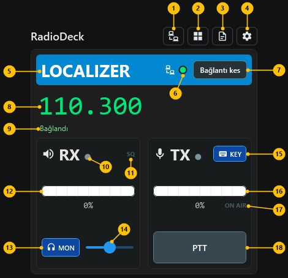

**Izgara görünümü** sekiz telsize kadar, satır başına dört küçük kutucuk
gösterir. Numaralar iki resimde de aynı anlama gelir:

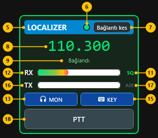

**Hangi görünüm?** İki telsizle çalışan küçük istasyonlarda, örneğin
localizer ve glide path ile yapılan flight check (uçuş kontrol) çalışmasında
klasik görünüm uygundur. Daha çok telsiz bağlanacaksa ızgara görünümünü
kullanın; sekiz telsize kadar hepsini tek ekranda gösterir.

**Üstteki düğmeler**

| No | Öğe | Ne işe yarar |
|---|---|---|
| 1 | Tümünü bağla | Bütün telsizleri bağlar; bağlıysa hepsinin bağlantısını keser. |
| 2 | Görünüm | Klasik ve ızgara görünümü arasında geçiş yapar. |
| 3 | Günlük | [Günlük penceresini](#11-günlük-penceresi) açar. |
| 4 | Ayarlar | Ayarları açar. Ayarlar açıkken PTT çalışmaz. |

**Her telsizde**

| No | Öğe | Ne işe yarar |
|---|---|---|
| 5 | Ad | Telsize verdiğiniz ad. Fareyi üzerinde bekletirseniz adreslerini gösterir. |
| 6 | Durum lambası | Gri = bağlantı yok, sarı = bağlanıyor ya da yalnızca bir yönü bağlı, yeşil = bağlandı, kırmızı = başarısız. |
| 7 | Bağlan | **Bağlan** telsizi arar, **İptal** kurulmakta olan çağrıyı durdurur, **Bağlantı kes** çağrıyı bitirir. |
| 8 | Frekans | Değiştirmek için çift tıklayın, bkz. [10. adım](#10-frekans-değiştirme). Parlak = telsiz doğruladı, soluk = bilinen son değer, `---.---` = bilinmiyor. |
| 9 | Durum satırı | Durumu sözle, hata olduğunda nedeniyle birlikte gösterir; örneğin *8 sn içinde yanıt yok*. |
| 10 | Etkinlik noktası | RX yanındaki: ses alınırken yeşil. TX yanındaki: ses gönderilirken yeşil. (Yalnızca klasik görünümde.) |
| 11 | SQ | Alıcı squelch'in açıldığını, yani sinyal aldığını bildirdiğinde yanar. |
| 12 | RX göstergesi | Alınan sesin düzeyi. |
| 13 | MON | Dinleme anahtarı: açıkken bu telsizin aldığı ses bilgisayarda çalınır. Kapatmak yalnızca sesi keser; bağlantı sürer. |
| 14 | Ses düzeyi | Bu telsizin ses yüksekliği. Izgara görünümünde ses düzeyi Ayarlar → Telsizler'den ayarlanır. |
| 15 | KEY | Açıkken klavyedeki PTT tuşu bu telsizden gönderme yapar. Yalnızca dinlediğiniz telsizlerde kapatın. |
| 16 | TX göstergesi | Gönderme sırasında mikrofonunuzun düzeyi. |
| 17 | ON AIR / AIR | Verici göndermeye geçtiğini doğruladığında yanar. Her telsiz bunu bildirmez. |
| 18 | PTT | Yalnızca bu telsizden göndermek için fareyle basılı tutun. Telsiz göndermedeyken kırmızı olur ve **GÖNDERİYOR** yazar. |

Ses alan telsiz yeşille vurgulanır; gönderme yapan telsizde kırmızı
**GÖNDERİYOR** düğmesi görünür:

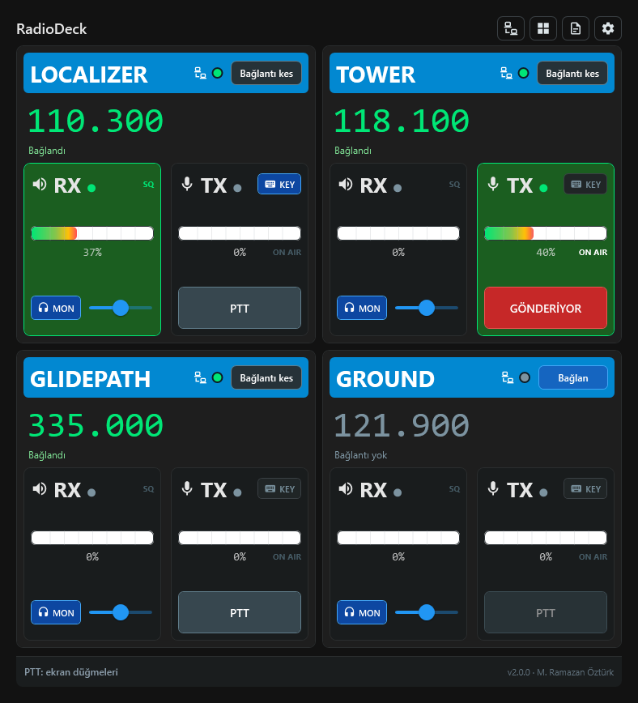

**Alt bilgi.** Solda kullanılan PTT tuşu (tuş kullanılamıyorsa *PTT: ekran
düğmeleri*), sağda sürüm ve Ayarlar → Genel'de girilen kuruluş metni yer
alır. Uyarılar üstteki düğmelerin altında renkli bir şeritte görünür; örneğin
gönderme süresi sınırı bir göndermeyi durdurduğunda.

## 5. Telsizleri girme

**Ayarlar**'ı açın (4 numaralı düğme) ve **Telsizler** sekmesinde kalın.

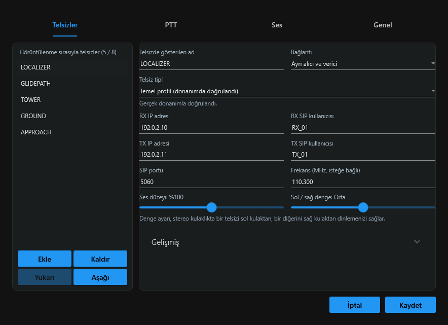

Soldaki liste telsizleri ekranda görünecekleri sırayla tutar. **Ekle** yeni
telsiz oluşturur (en fazla sekiz), **Kaldır** seçili olanı siler, **Yukarı**
ve **Aşağı** sırayı değiştirir. Bir telsizi seçip sağ tarafı doldurun:

| Alan | Anlamı |
|---|---|
| Telsizde gösterilen ad | Serbest metin, örneğin `TOWER` ya da `118.100`. Her telsizin adı farklı olmalıdır. |
| Bağlantı | **Ayrı alıcı ve verici**: iki adresli iki cihaz. **Alıcı-verici (tek adres)**: iki yön için tek cihaz. **Yalnızca alıcı**: yalnızca dinleme; telsizde PTT olmaz. |
| Telsiz tipi | **Temel profil** Jotron telsizlerinde denenmiştir. **Genel ED-137B** ve **ED-137C** standarda göre yazılmıştır ama donanımda denenmemiştir; temel profil reddedilirse bunları deneyin. |
| RX IP adresi / TX IP adresi | Alıcının ve vericinin adresleri. Alıcı-vericide tek alan vardır: *Telsiz IP adresi*. |
| RX SIP kullanıcısı / TX SIP kullanıcısı | Telsiz çağrıda bir kullanıcı adı bekliyorsa o ad. Telsiz adı tanımazsa çağrı adsız olarak yinelenir. |
| SIP portu | Telsiz başka ayarlanmadıysa 5060. |
| Frekans (MHz, isteğe bağlı) | Telsiz kendi değerini bildirene kadar gösterilen değer; frekans kontrolü olmayan telsizlerde yalnızca etikettir. |
| Ses düzeyi | %0 – %200. |
| Sol / sağ denge | Telsizi stereo kulaklığın sol ya da sağ kulağına verir; böylece iki telsiz birbirinden ayırt edilir. |

**Kaydet** her şeyi saklar; **İptal** değişiklikleri atar. Yalnızca adresi,
kullanıcısı ya da tipi değişen telsizler yeniden bağlanır.

### Gelişmiş: frekans kontrolü ve oturum açma

Kaydırıcıların altındaki **Gelişmiş**'e tıklayın. Çoğu kurulumda buraya
dokunmak gerekmez.

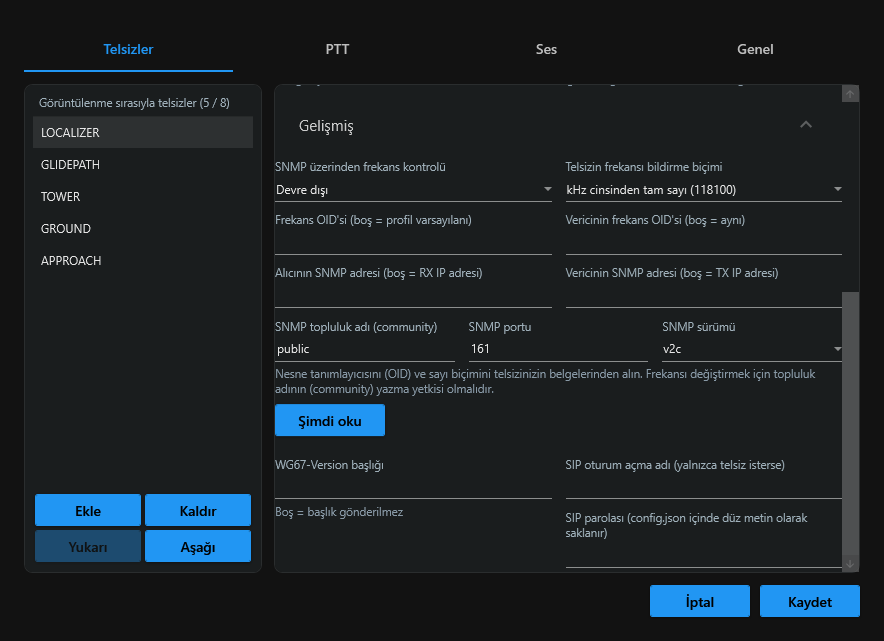

| Alan | Anlamı |
|---|---|
| SNMP üzerinden frekans kontrolü | *Profil varsayılanı*, *Etkin* ya da *Devre dışı*. Frekans kontrolü açıkken program frekansı telsizden okur ve değiştirebilir. |
| Telsizin frekansı bildirme biçimi | kHz cinsinden tam sayı, Hz cinsinden tam sayı ya da MHz cinsinden metin. Telsizin belgelerinden alın. |
| Frekans OID'si | Frekansı tutan nesne. Boş bırakılırsa telsiz tipinin varsayılanı kullanılır; genel tiplerin varsayılanı yoktur. |
| Vericinin frekans OID'si | Yalnızca verici alıcıdan farklı bir nesne kullanıyorsa. |
| Alıcının / vericinin SNMP adresi | Yalnızca SNMP çağrılardan farklı bir adreste çalışıyorsa, örneğin bir yönetim arayüzünde. |
| SNMP topluluk adı, portu, sürümü | Genellikle `public`, 161 ve v2c. Frekansı değiştirmek için topluluk adının yazma yetkisi olmalıdır. |
| **Şimdi oku** | Frekansı girilen değerlerle, kaydetmeden okur ve her cihazın yanıtını gösterir. Değerleri denemek için kullanın. |
| WG67-Version başlığı | Yalnızca genel telsiz tiplerinde, telsiz başka bir değer istiyorsa. |
| SIP oturum açma adı ve parolası | Yalnızca telsiz kimlik doğrulama istiyorsa. Parola yapılandırma dosyasında düz metin olarak saklanır. |

SNMP hakkında daha fazlası README'deki
[Frequency control](../README.md#frequency-control-snmp) bölümündedir.

## 6. PTT tuşunu seçme

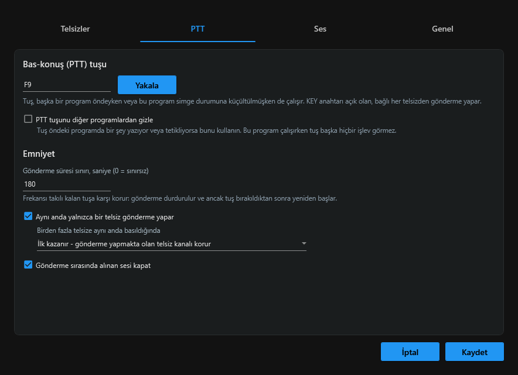

| Alan | Anlamı |
|---|---|
| Bas-konuş (PTT) tuşu | **Yakala**'ya, ardından kullanmak istediğiniz tuşa basın. Hazır değer F9'dur. Yazı yazarken kullanmadığınız bir tuş seçin; işlev tuşları uygundur. |
| PTT tuşunu diğer programlardan gizle | Tuş öndeki programda hiçbir şey yapmaz (yazı yazmaz, bir şey tetiklemez). |
| Gönderme süresi sınırı | Bundan uzun süren göndermeyi durdurur; takılı kalan tuşa karşı korur. Hazır değer 180 saniyedir; 0 sınırı kapatır. |
| Aynı anda yalnızca bir telsiz gönderme yapar | Açık: aynı anda tek verici. Kapalı: basılan bütün telsizler birlikte gönderir. |
| Birden fazla telsize aynı anda basıldığında | *İlk kazanır*: gönderme yapmakta olan telsiz kanalı korur. *Son kazanır*: en son basış kanalı alır. *Öncelik*: listede en üstteki telsiz kazanır. |
| Gönderme sırasında alınan sesi kapat | Siz gönderirken bütün alıcıların sesini keser; kendinizi duymazsınız. |

Tuş, başka bir program öndeyken ya da RadioDeck simge durumundayken de
çalışır. **KEY** anahtarı (15) açık olan, bağlı her telsizden gönderme yapar.
Klavye tuşu gönderen bir USB ayak pedalı ya da el anahtarı da aynı şekilde
yakalanabilmelidir; kendi bilgisayarınızda deneyin.

## 7. Ses aygıtları

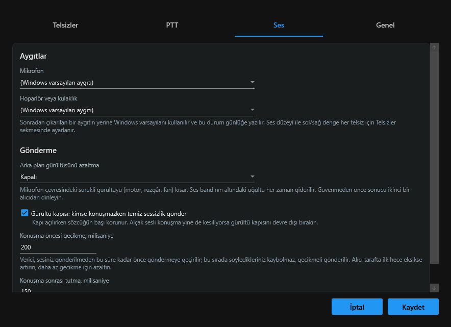

| Alan | Anlamı |
|---|---|
| Mikrofon | Giriş aygıtı. *Windows varsayılan aygıtı* Windows'taki ayarı izler. |
| Hoparlör veya kulaklık | Çıkış aygıtı. |
| Arka plan gürültüsünü azaltma | Kapalı, Normal ya da Güçlü. Mikrofon çevresindeki motor, fan gibi sürekli gürültüyü kısar. Güvenmeden önce sonucu ikinci bir alıcıdan dinleyin. |
| Gürültü kapısı | Açık: kimse konuşmazken temiz sessizlik gönderilir. Alçak sesli konuşma kesiliyorsa kapatın. |
| Konuşma öncesi gecikme | Vericinin göndermeye geçmesi ile sesinizin gönderilmesi arasındaki süre (hazır değer 200 ms). Karşı tarafta ilk hece eksikse artırın. |
| Konuşma sonrası tutma | Son sözcükten sonra vericinin göndermede kaldığı süre (hazır değer 150 ms). Sonu kesiliyorsa artırın. |

Mikrofon düzeyini Windows'tan, konuşurken TX göstergesi (16) belirgin biçimde
oynayacak ama sürekli tepede kalmayacak şekilde ayarlayın.

## 8. Genel seçenekler

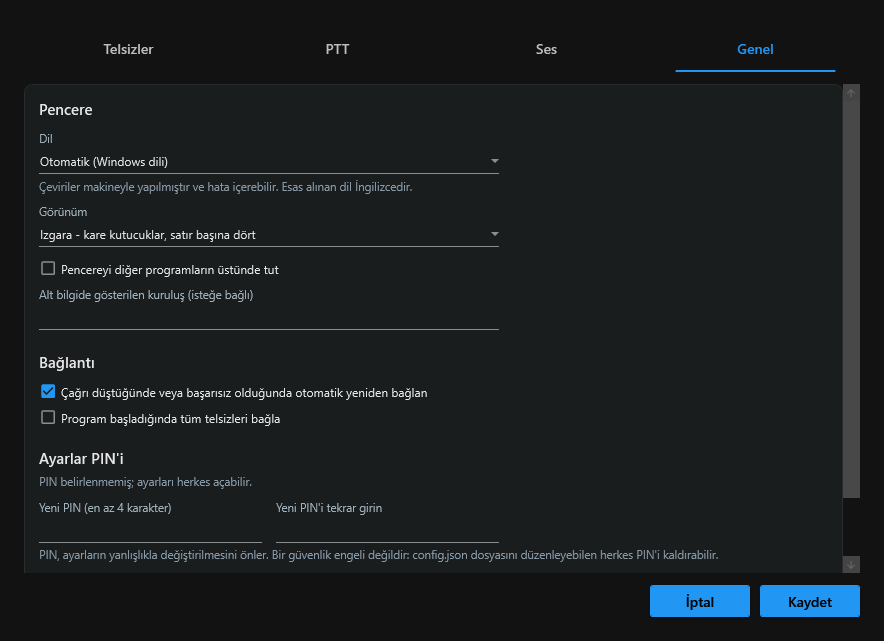

| Alan | Anlamı |
|---|---|
| Dil | *Otomatik* Windows'u izler. Değişiklik kaydedince uygulanır; yeniden başlatmak gerekmez. |
| Görünüm | Programın açıldığı görünüm: klasik ya da ızgara. |
| Pencereyi diğer programların üstünde tut | Pencere diğer programların üzerinde görünür kalır. |
| Alt bilgide gösterilen kuruluş | Ana pencerenin sağ altında görünen serbest metin. |
| Otomatik yeniden bağlan | Başarısız olan ya da düşen çağrı 2, 4, 8 ve sonra her 15 saniyede bir yinelenir. |
| Program başladığında tüm telsizleri bağla | Yalnızca bu programı çalıştıran bilgisayarlar için kullanışlıdır. |
| Ayarlar PIN'i | Ayarları yanlışlıkla değiştirilmeye karşı korumak için en az dört karakterlik bir PIN'i iki kez girin. **PIN'i kaldır** PIN'i siler. |

PIN belirlenmişse ayarlar açılırken sorulur:

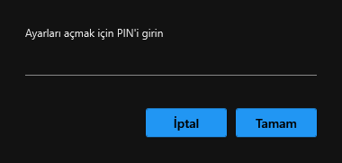

Üç yanlış girişten sonra ayarlar 30 saniye kilitli kalır. PIN hataya karşı
korur, bilgisayara erişimi olan birine karşı değil: yapılandırma dosyasından
kaldırılabilir.

## 9. Bağlanma ve deneme

Bunu her telsiz için bir kez, ikinci bir alıcıyla ya da dinleyen bir
arkadaşınızla yapın.

1. Telsizde **Bağlan**'a (7) ya da **Tümünü bağla**'ya (1) basın. Lamba (6)
   önce sarı, sonra yeşil olur; durum satırında (9) *Bağlandı* yazar.
   Kırmızı olursa durum satırı nedenini söyler; bkz.
   [12. adım](#12-bir-şey-çalışmıyorsa).
2. **Alma.** Birinden o frekansta gönderme yapmasını isteyin. **SQ** (11)
   yanar, RX göstergesi (12) oynar ve **MON** (13) açıksa sesi duyarsınız.
3. **Gönderme.** **KEY**'i (15) açıp PTT tuşunu basılı tutun, ya da **PTT**
   düğmesini (18) fareyle basılı tutun. Düğmede **GÖNDERİYOR** yazar, TX
   göstergesi (16) sesinizi izler ve telsiz bildiriyorsa **ON AIR** (17)
   yanar. Dinleyene ilk ve son sözcüğün eksiksiz gelip gelmediğini sorun.
4. **Bağlantıyı birkaç dakika boşta bırakın.** Lamba yeşil kalmalıdır.
5. Birden fazla telsiz varsa **KEY**'i yalnızca konuşmak istediğiniz telsizde
   açın. *Aynı anda yalnızca bir telsiz gönderme yapar* açıkken seçili
   telsizlerden yalnızca biri göndermeye geçer.

## 10. Frekans değiştirme

Frekansa (8) çift tıklayın. Yeni değeri yazıp **Ayarla**'ya ya da
<kbd>Enter</kbd>'a basın; **İptal** ya da <kbd>Esc</kbd> değeri değiştirmez.

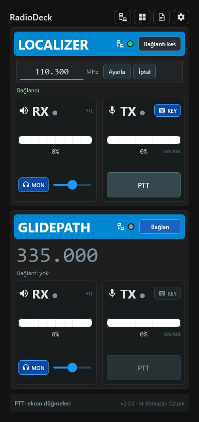

`123.450`, `123,45`, `123450` ya da `123` biçimleri, 108–156 MHz ya da
225–400 MHz aralığında kabul edilir. Frekans kontrolü açıkken değer alıcıya
ve vericiye yazılır, sonra geri okunur; telsiz doğrulayana kadar soluk kalır.
Telsiz reddederse durum satırında *Frekans değiştirilmedi* ve nedeni yazar.
Frekans kontrolü yoksa bu sayı yalnızca karttaki bir etikettir.

## 11. Günlük penceresi

3 numaralı düğme günlüğü açar. Günlük her çağrıyı telsizin yanıtıyla
birlikte, canlı tutma (keepalive) paketlerini ve her PTT'yi kaydeder.
Başkasına iletilebilsin diye her zaman İngilizce yazılır.

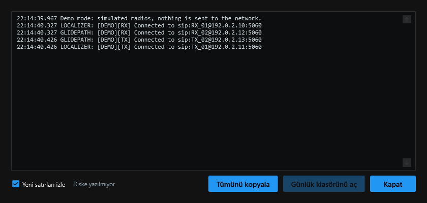

| Öğe | Ne işe yarar |
|---|---|
| Yeni satırları izle | En yeni satırı görünür tutar. Eski satırları rahat okumak için işareti kaldırın. |
| Tümünü kopyala | Günlüğü panoya kopyalar; örneğin bir sorun bildirimine eklemek için. |
| Günlük klasörünü aç | Günlük dosyalarının bulunduğu klasörü açar. Dosyalar 30 gün saklanır. |

Günlüğü başkasına vermeden önce gözden geçirin: telsizlerinizin adreslerini
ve SIP kullanıcı adlarını içerir.

## 12. Bir şey çalışmıyorsa

| Gördüğünüz | Bakılacak yer |
|---|---|
| *8 sn içinde yanıt yok* | Adres, kablo, güvenlik duvarı, telsiz açık mı. `ping` deneyin. |
| *telsiz 404 Not Found yanıtını verdi* | Telsiz SIP kullanıcı adını tanımıyor. |
| *telsiz 486 …* ya da *503 … yanıtını verdi* | Telsiz meşgul; çoğunlukla başka bir konsol bağlı. |
| Genel telsiz tipi reddediliyor | Günlüğü açın; diğer ED-137 tipini ya da başka bir *WG67-Version* değerini deneyin. |
| Bağlandı ama ses yok | Windows Güvenlik Duvarı (programa özel ağlarda izin verin), **MON** anahtarı, Ayarlar → Ses'teki çıkış aygıtı, telsizin ses düzeyi. |
| Sizi kimse duymuyor | **KEY** anahtarı, Ayarlar → Ses'teki mikrofon, Windows'taki mikrofon düzeyi. TX göstergesi oynuyor mu? |
| PTT tuşu çalışmıyor | Ayarlar penceresi açık mı kaldı? Başka bir telsiz zaten gönderiyor mu? Tuşu Ayarlar → PTT'den yeniden yakalayın. |
| *Frekans değiştirilmedi* | SNMP topluluk adı (yazma yetkisi), port, telsizde SNMP açık mı. Ayarlar → Telsizler → Gelişmiş'teki **Şimdi oku**'yu deneyin. |

Tam liste README'deki [Troubleshooting](../README.md#troubleshooting)
bölümündedir.

## 13. Güncelleme ve kaldırma

- **Güncelleme:** yeni `RadioDeckSetup.exe` dosyasını eski sürümün üzerine
  kurun. Önce programı kapatın. Ayarlarınız korunur.
- **Kaldırma:** Windows Ayarları → Uygulamalar → RadioDeck → Kaldır.
- **Ayarlarınız** `%AppData%\RadioDeck\config.json` dosyasında, günlükler
  `%AppData%\RadioDeck\logs` klasöründedir. Program kaldırılınca bunlar
  kalır; onları da silmek için klasörü silin. Ayarları başka bir bilgisayara
  taşımak için `config.json` dosyasını kopyalayın.
